# Summary

Simulation supplies most of the exposure behind modern automated-driving safety arguments, because real driving produces dangerous situations too slowly to measure their rates directly. Simulated miles are only useful as evidence if the simulated road users around the vehicle behave like real ones, and the behaviour that matters most is the rare, close interaction. This study builds and tests a procedure for answering a narrow version of that question: for a given type of traffic situation, how far do safety measures computed in simulation differ from the same measures in the real recording, and is the difference small enough for a stated use?

The procedure runs every recorded scene twice, once as recorded and once with the other vehicles handed to a simulated driver, and compares the two versions vehicle by vehicle. It reports three numbers per scenario family: a bias δ (how much shorter or longer simulated time-to-collision is, as a ratio), a scatter ω (how much that ratio varies from vehicle to vehicle) and a tail ratio R (how much more or less often simulated vehicles come within 1.5 s of a collision). It then compares those numbers with the credibility level required by the decision, following the risk-informed logic of ASME V&V 40, and, if the simulation qualifies, says how much simulated exposure is worth in a Bayesian event-rate estimate.

The procedure was applied to 2,000 scenes of the Waymo Open Motion Dataset (WOMD), simulated in closed loop with the open-source Waymax simulator, using three simple driver models that come with or are easy to build in Waymax (two settings of the Intelligent Driver Model and a constant-speed model) plus log replay as a check. The main observations are:

- Log replay reproduces the recording exactly (δ = 1, ω = 0, R = 1 in every family), so the pipeline itself adds no error.
- With default IDM settings, simulated minimum time-to-collision was about half of the recorded value (δ between 0.38 and 0.67 by family), close calls below 1.5 s were 1.5 to 4.4 times as frequent, and 7.1% of simulated vehicles ran into something ahead of them, against 0.36% in the recordings.
- A hand-tuned, more cautious IDM matched the pooled close-call rate (R = 1.04) but not the behaviour of individual vehicles (ω = 1.10), and in lane changes it produced about half the recorded close calls.
- In every setting, the pooled numbers looked better than the worst scenario family. Reporting by family is what exposed the gaps.

None of the simple driver models met the credibility level assumed for the example decision. That is the expected outcome for rule-based baselines, and it is not a statement about Waymax as a platform, about learned simulation agents, or about any company's internal simulation, none of which were tested. The contribution is the procedure: a way to state, per scenario type and with uncertainty, how far a simulator is from recorded driving and what that implies for a specific use.

# 1. Motivation

Demonstrating a low crash rate by driving alone is slow. Kalra and Paddock (2016) estimated that a fleet would need about 275 million failure-free miles to show, at 95% confidence, a fatality rate no worse than the US human rate. Developers therefore rely heavily on simulation, where a recorded scene can be replayed, varied and re-run many times. Published industry practice includes careful checks of simulation results, for example reproducing a sample of simulated collision-avoidance scenarios on a test track (Kusano et al., 2022).

A simulated scene contains models of other road users. If those models brake later than real drivers, keep shorter gaps or ignore people entering the road, the frequency of close calls in simulation differs from reality, and any rate estimated from simulation inherits that difference. The error can go either way. Simulated traffic that is calmer than real traffic makes a system look safer than it is; more aggressive traffic makes it look riskier and sends engineering effort in the wrong direction.

Realism benchmarks such as the Waymo Open Sim Agents Challenge (Montali et al., 2023) score how plausible simulated traffic is across many features and are the established way to compare simulation agents. The question addressed here is complementary and narrower: for one safety measure, one type of situation and one intended use, how large is the simulated-versus-real difference, and is it acceptable? Fields that use computational models for safety decisions, such as nuclear power and medical devices, answer this kind of question with credibility frameworks (Oberkampf and Roy, 2010; ASME V&V 40, 2018). This study borrows that logic.

Four questions guide the work:

1. How far do simulated safety measures (minimum time-to-collision and collisions) differ from recorded ones, in each type of situation?
2. Does the simulation reproduce the frequency of close calls, not only typical behaviour?
3. Given those differences, does the simulation reach the credibility required for a stated decision?
4. If it does, how much is simulated exposure worth when estimating an event rate?

# 2. Data and simulation set-up

## 2.1 Data

All real-data results use WOMD version 1.1, validation split (Ettinger et al., 2021), in the tf.Example format that Waymax reads. A scene covers 9.1 s at 10 Hz. Waymax keeps up to 32 objects per scene; each object has a position, heading, velocity, box size, type (vehicle, pedestrian or cyclist) and a flag marking the autonomous vehicle that recorded the scene. The first 1.1 s are history, and simulation covers the remaining 8 s.

| Item | Value |
| --- | --- |
| Dataset | WOMD v1.1, validation split, 150 files of about 300 scenes |
| Scenes used | 2,000 (the first files of the split, read in order) |
| Vehicles analysed | 13,195 moving vehicles other than the recording vehicle |
| Selection | reaches 2 m/s, tracked at the start and for at least half of the 8 s window |
| Run time | about 0.4 s per scene on a laptop CPU |

The data are used for non-commercial research under the Waymo Open Dataset licence. Raw scenes and per-vehicle values are not redistributed; only aggregate results are published.

## 2.2 Running each scene twice

Each scene is run in two versions with identical starting states at t = 1.1 s:

- **Recorded:** every object follows its log.
- **Simulated:** every vehicle other than the recording vehicle is controlled by a simulated-driver model; the recording vehicle, pedestrians and cyclists replay their logs.

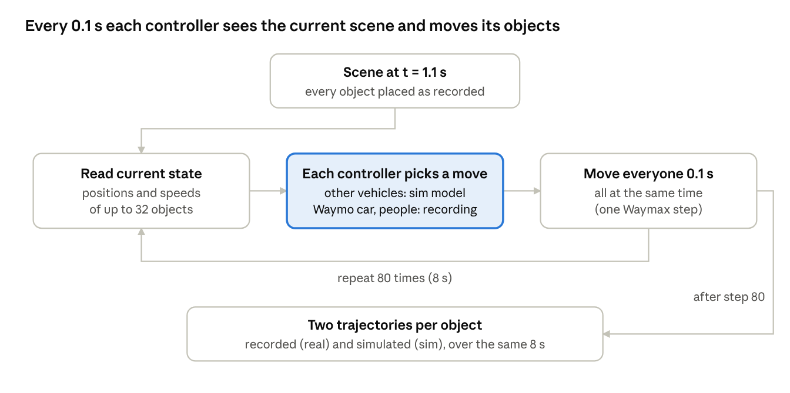{width=88%}

The simulation is closed loop: at each 0.1 s step every model reads the current positions of all objects and chooses its next move, so a simulated car reacts to what other simulated cars did a moment earlier. Because pedestrians, cyclists and the recording vehicle replay their logs, they cannot react to simulated vehicles. Section 3.3 measures how often that causes a collision; it turned out to be uncommon (0.6% of vehicles).

## 2.3 Simulated-driver settings

| Setting | Behaviour | Purpose |
| --- | --- | --- |
| `log` | Replays the recording | Check: every comparison must show perfect agreement |
| `idm` | Waymax `IDMRoutePolicy` with the default parameters of the installed version (among them a desired speed of 30 m/s, a 2 m minimum spacing and a look-ahead of 10 route points) | Standard baseline |
| `idm_cautious` | The same policy with desired speed 15 m/s, minimum spacing 4 m, look-ahead 20 points plus 20 m | Tests whether simple tuning closes the gap; chosen by hand |
| `constant_speed` | Keeps its speed and heading from t = 1.1 s | Deliberately weak reference |

The Intelligent Driver Model (Treiber, Hennecke and Helbing, 2000) sets acceleration from the desired speed and the gap to the vehicle ahead. In `IDMRoutePolicy` each vehicle follows its recorded path and chooses only its speed, so the comparison isolates longitudinal behaviour: speed choice and spacing. IDM is a long-established car-following model and a common baseline; it is not designed to anticipate cut-ins or road users entering from the side, and it is included in Waymax as a simple reference agent rather than as a model of human driving.

The cautious parameters were chosen after looking at the default results on the same scenes. They show what simple tuning can and cannot change, but they have not been tested on held-out scenes.

# 3. Safety measures

## 3.1 Time-to-collision

For each vehicle i (the follower) and each other object j, the relative position is expressed in the follower's frame, with the follower heading ψᵢ:

$$
\ell_{ij} = (x_j - x_i)\cos\psi_i + (y_j - y_i)\sin\psi_i, \qquad n_{ij} = -(x_j - x_i)\sin\psi_i + (y_j - y_i)\cos\psi_i
$$

Object j counts as a lead when it is ahead (ℓ > 0), overlaps the follower's path sideways (|n| < (Wᵢ + Wⱼ)/2, with W the box width) and, if it is a vehicle, heads within 45° of the follower. Pedestrians and cyclists count at any heading. The bumper gap and the closing speed along the follower's heading are

$$
g_{ij} = \ell_{ij} - \frac{L_i + L_j}{2}, \qquad c_{ij} = (v_{x,i} - v_{x,j})\cos\psi_i + (v_{y,i} - v_{y,j})\sin\psi_i
$$

with L the box length. Time-to-collision is defined only before contact:

$$
\mathrm{TTC}_{ij}(t) = \frac{g_{ij}(t)}{c_{ij}(t)} \ \text{ if } g_{ij} > 0 \text{ and } c_{ij} > 0, \quad \infty \text{ otherwise}; \qquad \mathrm{TTC}^{\min}_i = \min_t \min_j \mathrm{TTC}_{ij}(t)
$$

Values above 10 s are treated as no conflict. A minimum TTC below 1.5 s is used as the definition of a close call (a serious conflict), a threshold commonly used in traffic-conflict studies.

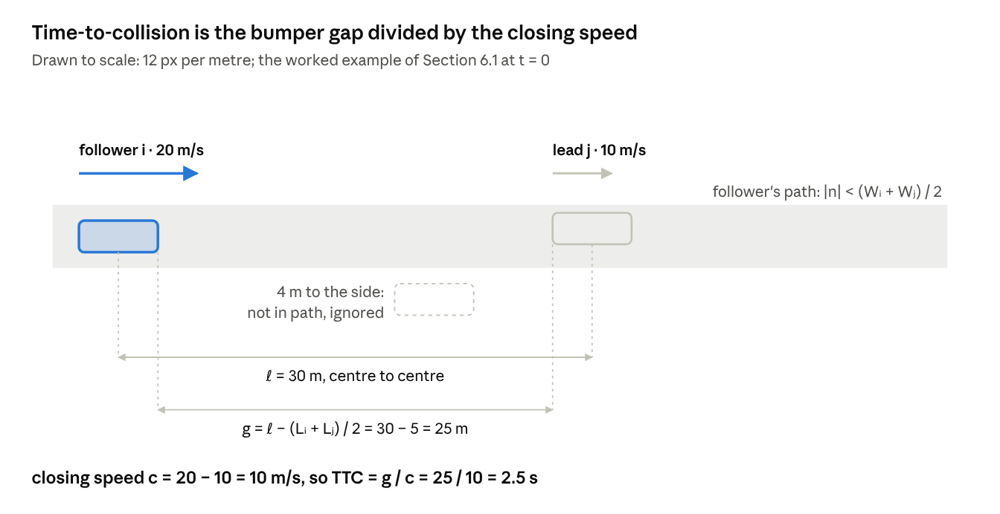{width=88%}

Worked example (one of the automated tests): a 5 m follower at 20 m/s and a 5 m lead at 10 m/s start 30 m apart (centre to centre), 0.5 m to the side. The gap is 25 m and closes at 10 m/s, so TTC = 2.5 s; after 0.9 s the gap is 16 m and TTC = 1.6 s, the minimum over a 1 s window.

This TTC is one-dimensional. It is suited to following situations and misses most crossing conflicts, for which post-encroachment time would be the natural addition.

## 3.2 Collisions

A collision is counted when two objects' rotated boxes overlap at any step, using Waymax's pairwise overlap check. The recordings themselves show overlaps for 0.83% of vehicles. Real crashes are much rarer than that, so these overlaps come from tracking and box-size uncertainty, and 0.83% acts as a noise floor against which simulated rates should be read.

An earlier version of the code assigned TTC = 0 whenever simplified boxes touched, which produced 284 false contacts between vehicles driving side by side. TTC is now computed only while the gap is positive, and contacts are left to the overlap check.

## 3.3 Who collided with whom

For each vehicle's first collision, the partner's position at that moment in the vehicle's frame gives one of three labels:

| Partner position | Partner controlled by | Label | Interpretation |
| --- | --- | --- | --- |
| Ahead | anyone | Ran into something ahead | The vehicle drove into an object in front of it |
| Behind | log replay | Struck by a replayed road user | A side effect of mixing replayed and simulated objects |
| Behind | simulated driver | Struck by another simulated car | Counted as the other car's "ran into" |

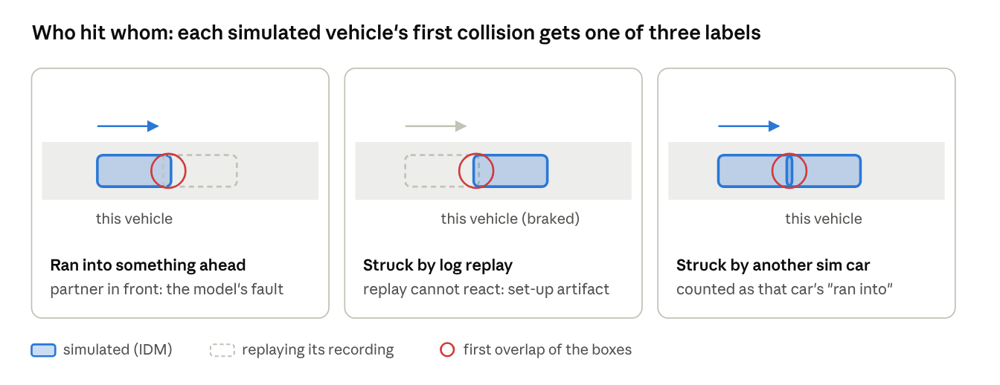{width=88%}

The label uses the partner's centre at first overlap, so side impacts fall into one class or the other depending on geometry.

# 4. Scenario families

A simulator can reproduce car following well and handle pedestrians poorly. If most of the data are car following, an average over all vehicles is dominated by it and the weakness near pedestrians barely moves the result. Each vehicle is therefore placed in one of five families, using features of its recorded drive so that it sits in the same family in both versions. Rules are checked in order and the first that applies wins.

| Priority | Family | Rule |
| --- | --- | --- |
| 1 | Pedestrian / cyclist | A pedestrian or cyclist comes within 15 m |
| 2 | Intersection (turning proxy) | Heading changes by more than 45° |
| 3 | Lane change | Sideways movement over 2.5 m with heading change under 20° |
| 4 | Car following | A lead is in the path at some point |
| 5 | Other | None of the above |

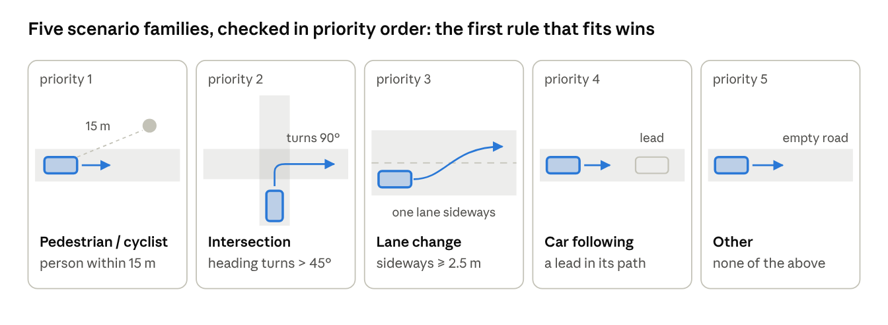{width=95%}

The thresholds are reasonable choices rather than fitted values and are kept in one place in the code. Without the road map, "intersection" means "turned"; vehicles driving straight through an intersection fall in other families. The "other" family has no lead vehicle by definition and therefore no close calls to compare.

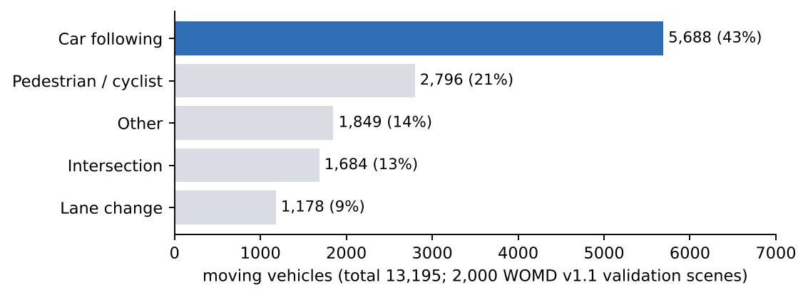{width=80%}

# 5. Comparing simulation with the recording

Three comparisons are made per family. They answer different questions, and in the results each catches problems the others miss.

| Metric | Question | Perfect value | Paired by vehicle? |
| --- | --- | --- | --- |
| Area metric d | How far apart are the two distributions? | 0 s | No |
| Bias δ | By what factor is a vehicle's simulated value off, typically? | 1 | Yes |
| Scatter ω | How much does that factor vary between vehicles? | 0 | Yes |
| Tail ratio R | How many times as often is TTC below 1.5 s in simulation? | 1 | No |

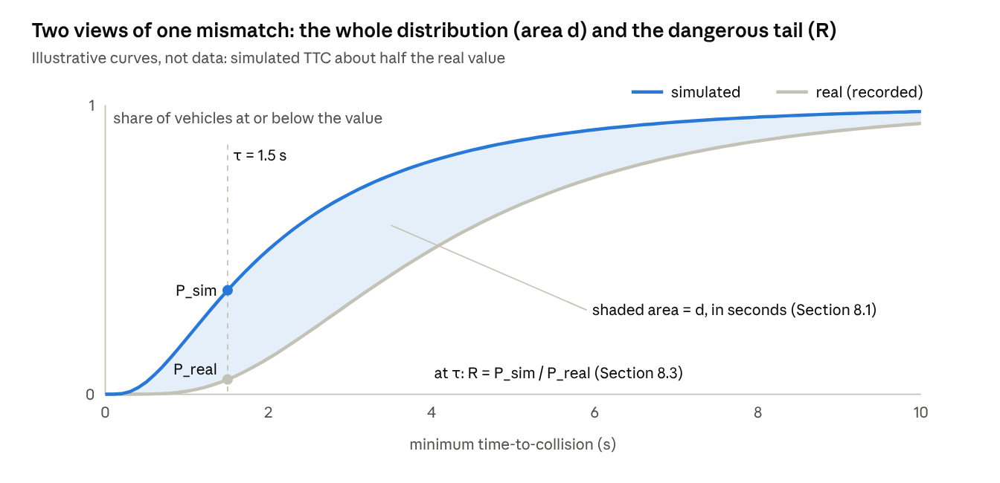{width=85%}

## 5.1 Area metric

The area metric of Ferson, Oberkampf and Ginzburg (2008) is the area between the empirical cumulative distribution functions of the simulated and recorded values, in the unit of the measure:

$$
d = \int \big|F_{\mathrm{sim}}(y) - F_{\mathrm{real}}(y)\big|\,dy
$$

With samples both curves are step functions and the integral is an exact sum. If the simulated values equal the recorded ones shifted by s, then d = s. TTC is capped at 10 s for this metric. The area metric cannot tell a difference among close calls from a difference among harmless encounters, which is why the tail ratio is reported alongside it.

## 5.2 Bias and scatter

For the same vehicle k, the simulated value is modelled as the recorded value times a bias factor and a random factor:

$$
Y^{\mathrm{sim}}_k = \delta\,\varepsilon_k\,Y^{\mathrm{real}}_k, \qquad \ln\varepsilon_k \sim \mathcal{N}(0, \omega^2)
$$

This multiplicative error model is the one used for fire-model uncertainty in nuclear probabilistic risk assessment (NUREG-1824 Supplement 1). Taking logarithms, rₖ = ln(Y^sim_k / Y^real_k) is normal with mean ln δ and standard deviation ω, so

$$
\hat\delta = \exp(\bar r), \qquad \hat\omega = \sqrt{\tfrac{1}{n-1}\textstyle\sum_k (r_k - \bar r)^2}
$$

δ̂ is the geometric mean of the simulated-to-recorded ratios. One standard deviation of error is a factor of e^ω: ω = 0.2 means typical errors of about 22%, and ω = 1 means a factor of about 2.7. Only vehicles with a finite, positive TTC in both versions enter δ and ω; the others still count in R. Intervals come from 2,000 bootstrap resamples of the pairs.

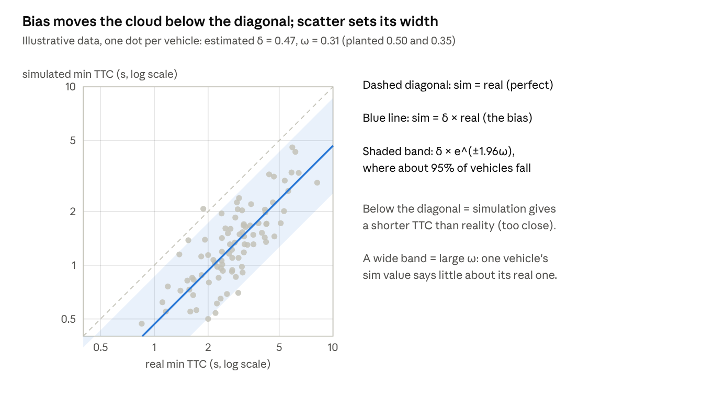{width=85%}

## 5.3 Tail ratio

With k vehicles below τ = 1.5 s out of n in each version,

$$
R = \frac{\hat P_{\mathrm{sim}}(\mathrm{TTC} < \tau)}{\hat P_{\mathrm{real}}(\mathrm{TTC} < \tau)}, \qquad \hat P = \frac{k + \tfrac12}{n + 1}
$$

The half-count keeps the ratio finite when a family has no events. R is reported only when the recording has at least five events. R above 1 means simulation produces too many close calls; below 1, too few.

For thresholds so low that even thousands of vehicles contain no recorded events, the code also estimates the tail with a generalised Pareto fit to the lowest 10% of values. On synthetic data it recovers the true tail probability within a factor of two. It was not needed for the results here.

# 6. Is the simulation good enough for the decision?

The required credibility depends on the decision; the achieved credibility depends on the comparison. Simulation is used only when achieved meets required. The structure follows ASME V&V 40-2018. The numerical thresholds are assumptions made for this study and are stated so that they can be challenged.

**Context of use.** The example decision is: estimate the rate of minimum TTC below 1.5 s among human-driven vehicles, as one input to a release decision.

**Required level.** Model risk combines how much the decision relies on the simulation (influence) with how bad a wrong decision would be (consequence). The example uses medium influence and high consequence, which gives a required level of 4 on a 1-to-5 scale.

| Influence \\ Consequence | Low | Medium | High |
| --- | --- | --- | --- |
| Low | 1 | 2 | 3 |
| Medium | 2 | 3 | 4 |
| High | 3 | 4 | 5 |

**Achieved level.** A level is achieved when all three of its conditions hold. The ranges are symmetric on a ratio scale.

| Level | δ within | ω at most | R within |
| --- | --- | --- | --- |
| 1 | 0.50 to 2.0 | 1.0 | 0.20 to 5.0 |
| 2 | 0.67 to 1.5 | 0.6 | 0.33 to 3.0 |
| 3 | 0.80 to 1.25 | 0.4 | 0.50 to 2.0 |
| 4 | 0.87 to 1.15 | 0.25 | 0.67 to 1.5 |
| 5 | 0.91 to 1.10 | 0.15 | 0.80 to 1.25 |

**Decision.** If achieved ≥ required, the simulation is credited. If achieved is one level short (and above zero), it may be used after its counts are corrected by R (Section 7). Otherwise it is not credited for this use. A separate yes/no check confirms that the validation scenes cover the situations the decision is about.

V&V 40 also weighs code verification, the quality of the comparison data and other evidence; this version scores only the validation comparison and the applicability check.

# 7. How much is simulated exposure worth?

## 7.1 Road data alone

With k events observed in exposure M and a Poisson model with the Jeffreys prior p(λ) ∝ λ^(−1/2), the posterior for the event rate λ is

$$
\lambda \mid k \sim \mathrm{Gamma}\big(k + \tfrac12,\ M\big)
$$

## 7.2 Adding simulation

Simulated counts are first divided by the validated tail ratio, k_sim/R, and then added through a power prior (Ibrahim and Chen, 2000) with weight a between 0 and 1:

$$
\lambda \mid \text{data} \sim \mathrm{Gamma}\Big(a\,\frac{k_{\mathrm{sim}}}{R} + k_{\mathrm{road}} + \tfrac12,\ \ a\,M_{\mathrm{sim}} + M_{\mathrm{road}}\Big)
$$

The term a·M_sim sits where road exposure sits, so it reads as the road-equivalent exposure the simulation is worth.

**Worked example.** Road: 6 events in 271.3 units of exposure. Simulation: 240 events in 2,713 units, with R = 4.

| Case | a | Posterior mean | 95% interval |
| --- | --- | --- | --- |
| Road only | 0 | 0.0240 | 0.0092 to 0.0456 |
| Simulation corrected by R | 0.35 | 0.0225 | 0.0149 to 0.0317 |
| Simulation corrected by R | 1 | 0.0223 | 0.0173 to 0.0279 |
| Simulation not corrected | 0.35 | 0.0741 | 0.0596 to 0.0902 |

With the correction, simulation narrows the interval by about half without moving the estimate. Without it, the same simulation triples the estimate, and the narrow interval makes the wrong answer look certain.

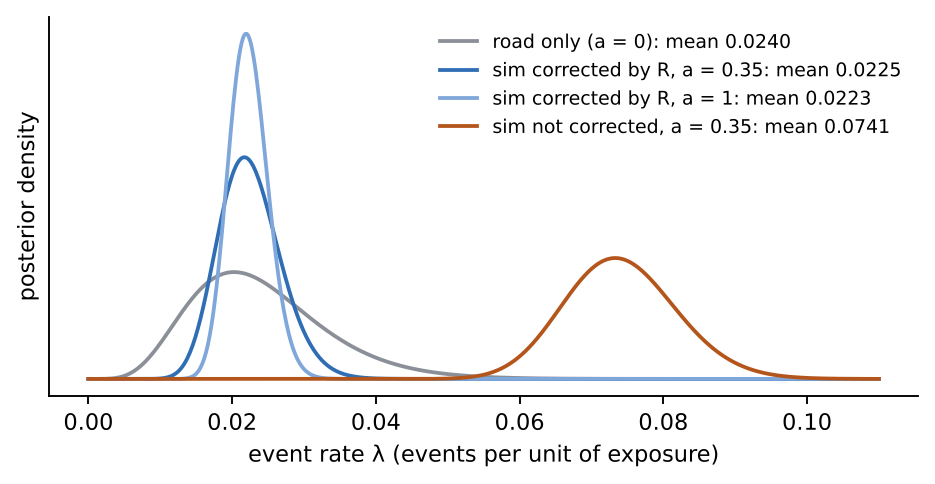{width=80%}

## 7.3 Choosing the weight

Three rules are compared rather than one assumed:

1. **From the credibility level** (assumed mapping): a = 0, 0.05, 0.15, 0.35, 0.60 and 0.90 for levels 0 to 5.
2. **From the scatter:** a = 1/(1 + (ω/0.3)²), which halves the weight at ω = 0.3 (an assumed reference value).
3. **Empirical Bayes:** the a that makes the observed road count most probable under the simulation-based prior (Gravestock and Held, 2017). Integrating λ out gives a negative binomial, maximised on a grid of a from 0.001 to 1.

Rule 3 lets the road data overrule a simulation that disagrees with it, but with few road events almost any simulation looks consistent, and it then gives too much weight. It should be used only with enough road events or alongside Rules 1 and 2.

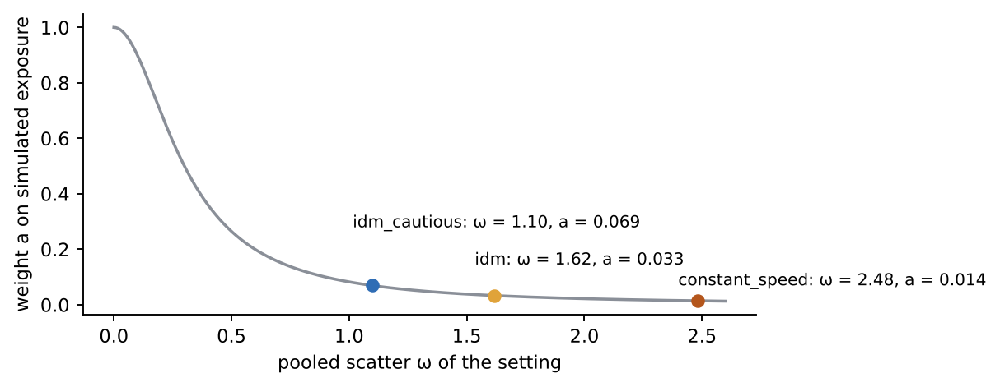{width=78%}

# 8. Results

## 8.1 Check on synthetic data

Before using real data, four synthetic families were given known errors and the pipeline was run on them.

| Family | Planted δ | Recovered δ | Planted ω | Recovered ω | Achieved level | Decision |
| --- | --- | --- | --- | --- | --- | --- |
| Car following | 1.05 | 1.054 | 0.15 | 0.150 | 4 | credit |
| Lane change | 1.30 | 1.295 | 0.35 | 0.343 | 2 | not credited |
| Intersection | 1.00 | 0.985 | 0.50 | 0.505 | 2 | not credited |
| Pedestrian / cyclist | 1.60 | 1.596 | 0.60 | 0.606 | 1 | not credited |
| Pooled |  | 1.137 |  | 0.379 |  |  |

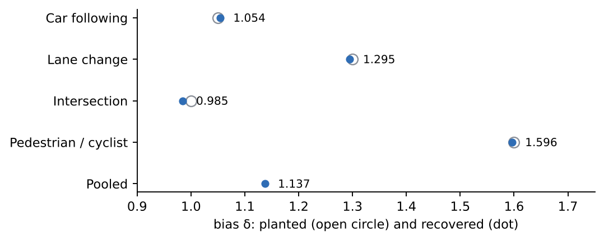{width=72%}

Every planted bias was recovered within 1.5%. Pooled over all scenes, the simulation looked close to acceptable (δ = 1.14, R = 1.07) although three of the four families were not.

## 8.2 Default IDM against the recordings

| Family | Vehicles | Pairs | δ (95% CI) | ω | R (95% CI) | Collisions: recorded / simulated | Achieved level |
| --- | --- | --- | --- | --- | --- | --- | --- |
| Pedestrian / cyclist | 2,796 | 901 | 0.47 (0.42 to 0.52) | 1.57 | 2.41 (2.04 to 2.94) | 1.0% / 13.4% | 0 |
| Intersection | 1,684 | 381 | 0.67 (0.58 to 0.77) | 1.52 | 1.52 (1.15 to 2.16) | 0.8% / 8.7% | 0 |
| Lane change | 1,178 | 299 | 0.38 (0.33 to 0.44) | 1.22 | 4.11 (3.07 to 5.87) | 0.5% / 7.0% | 0 |
| Car following | 5,688 | 2,461 | 0.42 (0.40 to 0.45) | 1.68 | 4.40 (3.89 to 4.95) | 0.7% / 9.0% | 0 |
| Other | 1,849 | 0 |  |  |  | 1.1% / 7.6% |  |
| Pooled | 13,195 | 4,042 | 0.45 (0.43 to 0.47) | 1.62 | 3.52 (3.20 to 3.87) | 0.8% / 9.5% |  |

With default parameters the simulated vehicles came closer to the objects ahead of them than the recorded drivers did: minimum TTC was about half the recorded value, and close calls were 1.5 to 4.4 times as frequent, most of all in car following and lane changes. Scatter between 1.2 and 1.7 means that a vehicle's simulated TTC says little about its recorded TTC even after the bias is removed. The pooled tail ratio of 3.52 understates the two largest family values. The pooled area metric was 0.38 s.

## 8.3 Causes of the simulated collisions

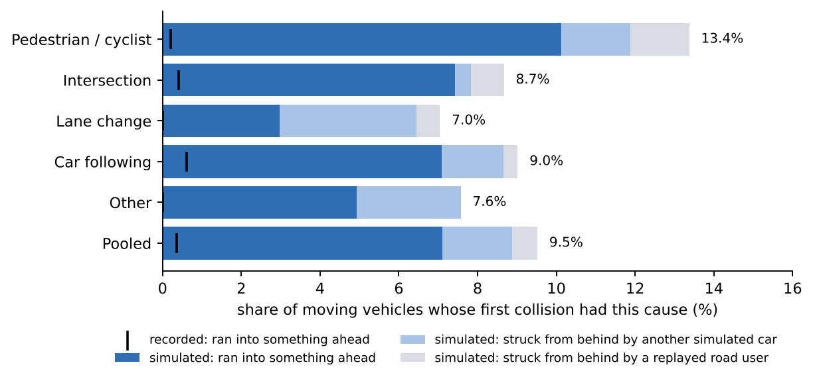{width=92%}

Most simulated collisions were simulated vehicles running into something ahead of them: 7.1% of vehicles, against 0.36% in the recordings. Being struck by a replayed road user that could not react accounted for 0.6% of vehicles, so the mixed set-up is a small contributor. The ran-into rate was highest in the pedestrian/cyclist family (10.1%), which fits a route-following model that responds to objects already on its path but not to road users entering it from the side. In lane changes, the most common cause was being struck by another simulated car (3.5%), which fits followers that do not anticipate a vehicle moving into their lane.

## 8.4 Four settings compared

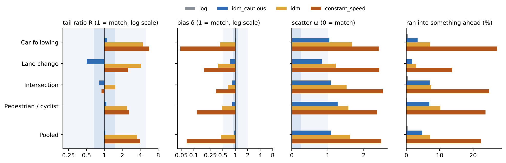{width=100%}

| Setting | Family | δ | ω | R | Ran into something ahead | Achieved level |
| --- | --- | --- | --- | --- | --- | --- |
| log | every family | 1.000 | 0.000 | 1.00 | equals the recording | 5 |
| idm_cautious | Car following | 1.016 | 1.042 | 1.10 | 3.4% | 0 |
| idm_cautious | Lane change | 0.743 | 0.834 | 0.51 | 1.8% | 1 |
| idm_cautious | Intersection | 0.828 | 1.084 | 0.81 | 7.0% | 0 |
| idm_cautious | Pedestrian / cyclist | 0.851 | 1.273 | 1.08 | 6.9% | 0 |
| idm_cautious | Pooled | 0.939 | 1.098 | 1.04 | 4.8% |  |
| idm | Pooled | 0.447 | 1.617 | 3.52 | 7.1% |  |
| constant_speed | Car following | 0.047 | 2.416 | 5.60 | 27.2% | 0 |
| constant_speed | Intersection | 0.339 | 2.526 | 0.90 | 24.8% | 0 |
| constant_speed | Pooled | 0.068 | 2.481 | 3.97 | 22.3% |  |
| Recorded driving | Pooled |  |  |  | 0.36% |  |

The comparison ranks the settings as expected on every pooled measure: from constant speed to default IDM to cautious IDM, δ moves toward 1 (0.07, 0.45, 0.94), ω falls (2.48, 1.62, 1.10) and the ran-into rate falls (22.3%, 7.1%, 4.8%).

Tuning changed the averages more than the vehicle-level behaviour. In car following the cautious setting reached δ = 1.02 (95% CI 0.98 to 1.06) and R = 1.10 (0.94 to 1.27), yet ω = 1.04 is just above the widest assumed limit of 1.0, and simulated vehicles still ran into something ahead more often than recorded ones (3.4% against 0.6%). Its pooled R of 1.04 sits next to a lane-change R of 0.51 (0.29 to 0.83): in that family the cautious setting would understate close calls.

A single metric can mislead. Constant speed scores R = 0.90 at intersections, close to a match, while its bias is δ = 0.34 and a quarter of its vehicles run into something. Only the measures read together, with the collision attribution, give a consistent picture.

Figure 13 shows the car-following case against each credibility level.

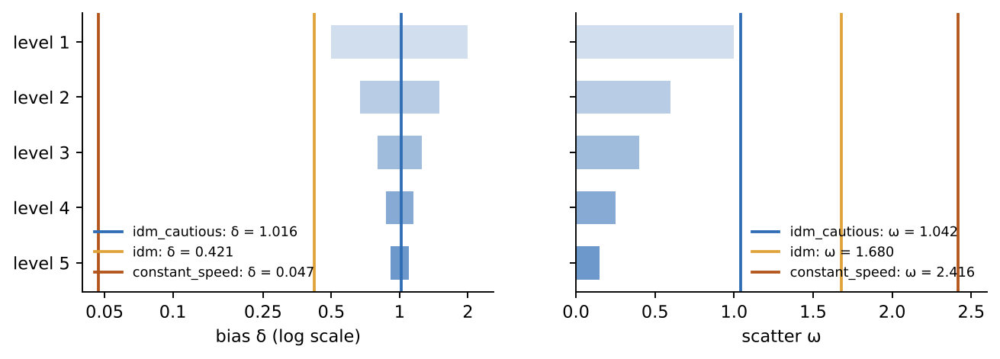{width=92%}

# 9. Discussion and limitations

**What the results say.** The procedure behaved as intended. It found planted errors on synthetic data, reported perfect agreement for log replay, ranked four driver models in the expected order, and located where each one departed from recorded driving and why. The most useful single finding is methodological: in every setting, and in the synthetic check, the pooled numbers looked better than the worst family. A credibility claim made for "the simulator" as a whole would have hidden this.

**What they do not say.** The driver models tested are rule-based baselines. Waymax is designed so that researchers can plug in stronger, learned agents, and benchmarks such as the Sim Agents Challenge exist to compare them. The results describe IDM-type and constant-speed agents in this configuration on these 2,000 scenes. They are not an assessment of Waymax as a simulator, of learned agents, or of any developer's internal tools. The recording vehicle replays its log, so nothing here concerns an automated driving system's own behaviour.

**Limitations.**

| Limitation | Effect | Possible next step |
| --- | --- | --- |
| One-dimensional TTC | Crossing conflicts are mostly missed | Add post-encroachment time and two-dimensional TTC |
| No road map | "Intersection" is a turning proxy | Use WOMD lane, intersection and crosswalk data |
| Mixed reactivity | Replayed objects cannot react (0.6% of vehicles struck by one) | Also run with all agents simulated |
| Assumed thresholds | Decisions depend on τ, the level limits and the weight rules | Sensitivity analysis; set thresholds with the people who own the decision |
| Cautious setting tuned on the same scenes | Its agreement is optimistic | Test on held-out scenes (later files of the split) |
| Paired TTC exists for a minority of vehicles | 4,042 of 13,195 pairs for default IDM | Add headway and distribution-level measures |
| One dataset | No independent real-world check | Add a second naturalistic dataset |
| Collision partner type not split | Cannot yet separate vehicle and pedestrian contacts | Break out partner types |

**Natural extensions.** Testing learned simulation agents with the same procedure would show how much of the gap reported here closes with better behaviour models, family by family. A companion repository (av-sim-vnv-evidence) uses the per-vehicle results of this study to ask a related question: when simulated and real outcomes are combined in one estimate, how much real data does simulation save?

# 10. Reproducing the results

The code is a small Python library, `avcred`, plus scripts. The library needs only NumPy and SciPy; the real-data runs also need Waymax and registered access to WOMD.

| Path | Content |
| --- | --- |
| `src/avcred/measures.py` | TTC, deceleration rate to avoid a crash, headway, peak deceleration, post-encroachment time |
| `src/avcred/womd.py` | Minimum TTC per vehicle from trajectories, family features, collision attribution |
| `src/avcred/scenarios.py` | The five family rules |
| `src/avcred/validation.py` | Area metric, bias and scatter with bootstrap, tail ratio (empirical and GPD) |
| `src/avcred/credibility.py` | Context of use, model risk, achieved level, decision |
| `src/avcred/evidence.py` | Gamma posterior, tail correction, power prior, three rules for the weight |
| `scripts/synthetic_pilot.py` | The synthetic check (Section 8.1) |
| `scripts/check_setup.py` | Confirms that Waymax can read WOMD on the machine |
| `scripts/womd_pilot.py` | The real-data runs, one setting at a time |
| `scripts/compare_agents.py` | Table comparing the settings |
| `scripts/make_figures.py` | Data figures of this report, from aggregate results only |
| `tests/test_core.py` | Ten tests against hand-worked answers |

```bash
python tests/test_core.py
python scripts/synthetic_pilot.py
for a in log idm idm_cautious constant_speed; do
  python scripts/womd_pilot.py --scenes 2000 --agent $a --local ~/womd
done
python scripts/compare_agents.py
python scripts/make_figures.py
```

The first scene takes a few seconds while JAX compiles the simulation step; afterwards each scene takes about 0.4 s on a laptop CPU, or about 15 minutes per setting for 2,000 scenes. `results/` holds the aggregate outputs (`womd_partA_<setting>.csv/json`, `agent_comparison.csv`, `pilot_*`). The per-vehicle files `womd_agents_<setting>.csv` are written locally and are excluded from the repository because they are derived from the dataset.

# Notes

**Data.** Results are derived from the Waymo Open Dataset (waymo.com/open), used under its licence for non-commercial research. No scene data or per-vehicle values are redistributed.

**Assumptions.** The credibility thresholds, the family rules, the conflict threshold τ = 1.5 s and the mapping from level to weight are judgements, stated as such.

**Tools.** Parts of the code and text were drafted with an AI assistant. The study design, the runs on the dataset, the checks of every reported number and the conclusions are the author's.

# References

- ASME (2018). V&V 40-2018, Assessing credibility of computational modeling through verification and validation: application to medical devices.
- Ettinger, S. et al. (2021). Large scale interactive motion forecasting for autonomous driving: the Waymo Open Motion Dataset. ICCV.
- Ferson, S., Oberkampf, W. L., Ginzburg, L. (2008). Model validation and predictive capability for the thermal challenge problem. Computer Methods in Applied Mechanics and Engineering 197, 2408–2430.
- Gravestock, I., Held, L. (2017). Adaptive power priors with empirical Bayes for clinical trials. Pharmaceutical Statistics 16, 349–360.
- Gulino, C. et al. (2023). Waymax: an accelerated, data-driven simulator for large-scale autonomous driving research. NeurIPS Datasets and Benchmarks.
- Ibrahim, J. G., Chen, M.-H. (2000). Power prior distributions for regression models. Statistical Science 15, 46–60.
- Kalra, N., Paddock, S. M. (2016). Driving to safety: how many miles of driving would it take to demonstrate autonomous vehicle reliability? RAND RR-1478.
- Kusano, K. D. et al. (2022). Collision avoidance testing of the Waymo automated driving system. arXiv:2212.08148.
- Montali, N. et al. (2023). The Waymo Open Sim Agents Challenge. NeurIPS Datasets and Benchmarks.
- Oberkampf, W. L., Roy, C. J. (2010). Verification and Validation in Scientific Computing. Cambridge University Press.
- Treiber, M., Hennecke, A., Helbing, D. (2000). Congested traffic states in empirical observations and microscopic simulations. Physical Review E 62, 1805–1824.
- US NRC (2016). NUREG-1824 Supplement 1, Verification and validation of selected fire models for nuclear power plant applications.
